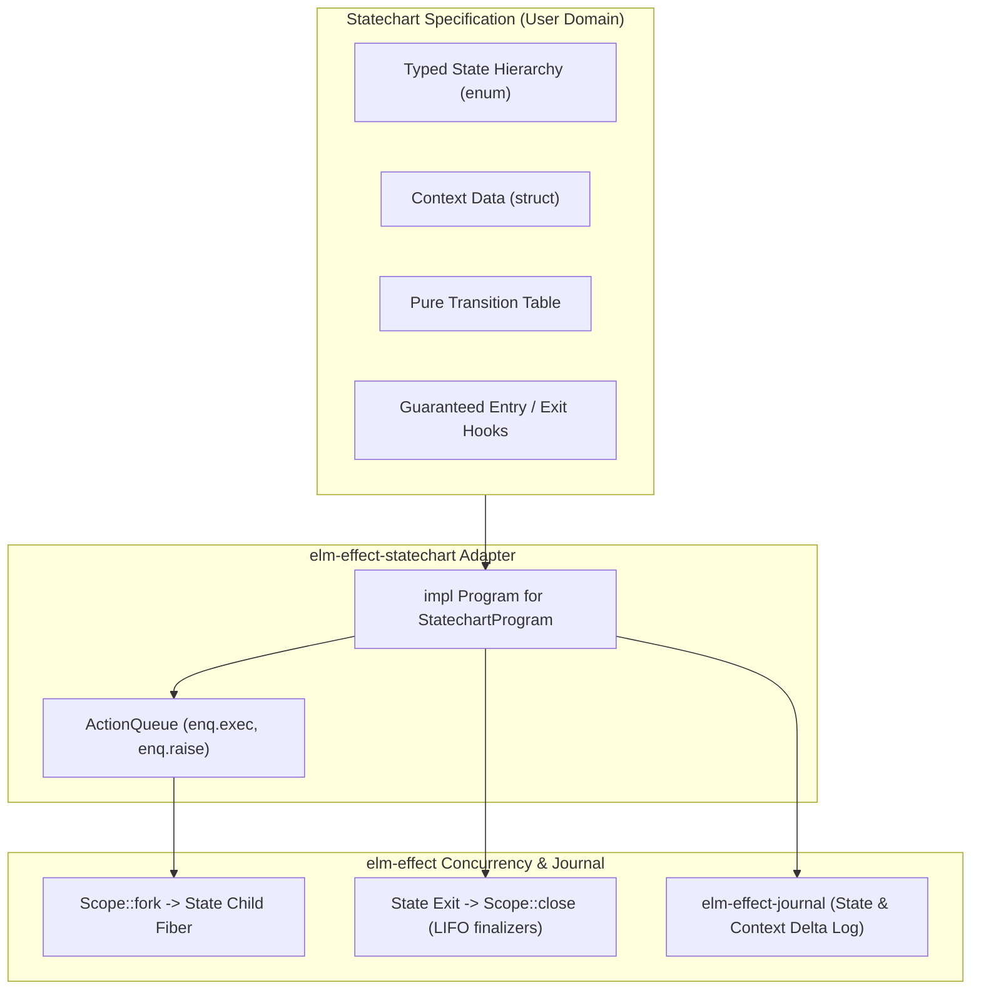

# Integrate Harel Statecharts and Actor Lifecycles into the Elm Loop

**Superseded (2026-11-10):** Superseded by [ADR-0007](0007-port-xstate-v6-into-rust-as-elm-effect-xstate.md). The original proposed trait-based wrapper in `elm-effect-elm` is superseded by the first-class `elm-effect-xstate` crate delivering complete XState v6 behavioral parity, the Actor model, and formal TLA+ verification.

## Context and Problem Statement

[`elm-effect-rs`](../../README.md) combines pure functional Elm loops ([`elm-effect-elm`](../../crates/elm-effect-elm)), structured concurrency ([`elm-effect`](../../crates/elm-effect)), and crash-proof durable logs ([`elm-effect-journal`](../../crates/elm-effect-journal)).

Under [ADR-0002](0002-port-effect-4-into-rust-with-an-elm-loop.md), long-lived interactive programs run through the Elm architecture:
`Program::update` takes `(model, msg)` and returns `(new_model, commands)`.

While this model guarantees determinism and testability, complex interactive applications, distributed multi-agent workflows, and protocols face three recurring failure modes when built purely on flat Elm reducers:

1. **State Space Explosion & Illegal Inhabitants**: A flat model with flags (`is_loading: bool`, `auth_token: Option<String>`, `retry_count: u32`, `error: Option<AppError>`) permits $2^N$ structural representations. In practice, many permutations represent contradictory, unhandled, or illegal states (`is_loading = false` with `auth_token = None` and `error = None`).
2. **Lifecycle Leaks and Command Orphanage**: In a pure Elm loop, commands emitted during a state are decoupled from the state's lifecycle. If an effect is in flight while in state `Connecting`, and the user issues `Cancel` (moving to `Idle`), the in-flight effect continues running in the background. When its outcome arrives, it enters the reducer during `Idle`, causing subtle race conditions or requiring defensive guards in every branch.
3. **Nested Component Boilerplate**: Sub-workflows require manual message routing and hierarchical enum wrapping (`PageMsg(Auth(Login(Submit)))`), leading to deep boilerplate matches and repetitive event bubbling.

[Stately's XState v6 (Beta)](https://github.com/statelyai/xstate) solves these challenges through **Harel statecharts** (hierarchical states, parallel regions, declarative entry/exit actions) and a simplified functional actor model (`(args, enq) => ({ context })`), culminating in `@xstate/effect` which couples actor lifecycles with Effect-TS fibers.

How should `elm-effect-rs` incorporate Harel statecharts and actor lifecycles for its users, while strictly preserving our core laws: no second runtime, zero-cost compile-time typing, pure reducers, and structured concurrency?

## Decision Drivers

* **Carrier Law ([ADR-0002](0002-port-effect-4-into-rust-with-an-elm-loop.md))**: `Effect<A, E, R>` is a lazy description. `Runtime::run` is called only at the process boundary. Pure reducers are maintained: I/O belongs at the edge.
* **Extension Law ([ADR-0003](0003-make-elm-effect-a-first-class-rust-framework.md))**: Applications extend the framework by supplying values of framework types (`ServiceTag`, `Program`, `DurableLog`), not by adding a second runtime, thread pool, or scheduler.
* **Durability Law ([ADR-0005](0005-durable-engine-port-and-our-engine.md))**: Single-host execution, append-only journaling, crash-proof replay, and monotonic generation fencing.
* **Compile-Time Correctness**: In Rust, state machine states must be strongly typed algebraic data types (`enum`), not dynamic runtime strings (`"idle.active.fetching"`).
* **Scope-Bound Actor Lifecycles**: The lifetime of an active state must equal the lifetime of an [`elm-effect::Scope`](../../crates/elm-effect/src/scope.rs). When a state exits, its child fibers must be automatically interrupted and its LIFO finalizers executed.
* **XState v6 Functional Simplicity**: Eliminate action creators (`assign`, `raise`, `sendTo`) and string guards. Handlers must be direct pure functions operating on a typed enqueue buffer.
* **Formal Verification Compatibility**: Machine topologies must cleanly export to Mermaid diagrams and TLA+ specifications for verification via [`scripts/verify-formal.sh`](../../scripts/verify-formal.sh).

## Considered Options

* **Option 1: Status Quo (Pure Flat Elm Loop Only)**. Retain only `Program::update`. Require users to manually manage state nesting, boolean flags, and manual task cancellation.
* **Option 2: Standalone Actor Runtime / Scheduler (Direct XState v4/v5 Port)**. Build an independent concurrent actor framework with dynamic mailboxes, background threads, and an event loop distinct from `elm-effect-elm`.
* **Option 3: Pure Statechart Abstraction Compiling to `Program` with Scoped Effect Invocations (`elm-effect-statechart`) [Chosen Option]**. Implement a pure, compile-time Harel statechart layer that compiles directly into an `elm-effect-elm::Program`. State entry and exit manage child [`Scope`](../../crates/elm-effect/src/scope.rs) handles, binding effect lifecycles to state transitions with zero second scheduler.

## Decision Outcome

Chosen option: **Option 3 ("Pure Statechart Abstraction Compiling to `Program` with Scoped Effect Invocations")**.

We introduce statechart capabilities into the framework through a dedicated module or crate ([`elm-effect-statechart`](../../crates/elm-effect-elm)). It provides a declarative, type-safe statechart specification that compiles directly down to an [`elm-effect-elm::Program`](../../crates/elm-effect-elm/src/program.rs).

### 1. The Core Architecture



### 2. Type-Safe Statechart Specification

Unlike JavaScript, which relies on string state paths, our statechart abstraction uses Rust algebraic enums to represent mutually exclusive states and compound substates:

```rust
pub trait Statechart: Sized + 'static {
    /// Mutually exclusive states (can be nested enums for compound states).
    type State: Clone + PartialEq + Eq + std::hash::Hash + Send + Sync + 'static;
    
    /// External events delivered to the machine.
    type Event: Clone + Send + Sync + 'static;
    
    /// Extended quantitative data attached to the machine.
    type Context: Clone + Default + Send + Sync + 'static;
    
    /// Output commands and internal messages.
    type Msg: Clone + Send + Sync + 'static;

    /// Initial state and context.
    fn initial(&self) -> (Self::State, Self::Context);

    /// Pure transition function: evaluates current state, context, and event.
    /// Returns the target state and optional context patch, or None if unhandled.
    fn transition(
        &self,
        state: &Self::State,
        ctx: &Self::Context,
        event: &Self::Event,
        enq: &mut ActionQueue<Self::Msg>,
    ) -> Option<(Self::State, Option<Self::Context>)>;

    /// Actions guaranteed to run when entering a state.
    fn entry(&self, _to: &Self::State, _ctx: &Self::Context, _enq: &mut ActionQueue<Self::Msg>) {}

    /// Actions guaranteed to run when exiting a state.
    fn exit(&self, _from: &Self::State, _ctx: &Self::Context, _enq: &mut ActionQueue<Self::Msg>) {}
}
```

### 3. The `ActionQueue` (XState v6 `enq` in Rust)

Following XState v6's removal of action creator indirection (`assign`, `raise`, `sendTo`), all side effects and context mutations in Rust use plain closures and a concrete enqueue buffer:

```rust
pub struct ActionQueue<Msg> {
    pub(crate) commands: Vec<Cmd<Msg>>,
    pub(crate) raised: Vec<Msg>,
}

impl<Msg> ActionQueue<Msg> {
    /// Enqueue a managed Effect command for runtime execution.
    pub fn exec(&mut self, cmd: Cmd<Msg>) {
        self.commands.push(cmd);
    }

    /// Enqueue an internal event to immediately re-enter the fold (enq.raise).
    pub fn raise(&mut self, msg: Msg) {
        self.raised.push(msg);
    }
}
```

### 4. Scope-Bound Actor Invocations (`from_effect`)

A critical contribution of this ADR is binding **State Lifetime to Fiber Scope Lifetime**:

When a statechart defines an invoked service in state $S$:
1. **Upon Entering State $S$**: The adapter opens a child [`Scope`](../../crates/elm-effect/src/scope.rs) under the program's root scope. The declared `Effect` is spawned as a child [`Fiber`](../../crates/elm-effect/src/fiber.rs).
2. **While in State $S$**: The fiber runs concurrently. If it completes successfully or with error, its outcome maps to a `Msg` and enters the fold.
3. **Upon Leaving State $S$**: When any transition moves away from $S$, the adapter immediately calls `scope.close()`. This delivers an interruption signal to the child fiber, terminates in-flight operations, and executes all registered LIFO finalizers.

*Guarantee*: No background effect can ever outlive the state that invoked it. Command orphanage is structurally impossible.

### 5. Durable Statecharts via `elm-effect-journal`

By integrating with [`elm-effect-journal::DurableLog`](../../crates/elm-effect-journal/src/durable_log.rs):
- Every state transition tuple `(old_state, event, new_state, epoch)` appends to the durable log before the entry action executes.
- Stale workers are fenced via epoch/generation checks.
- On process crash or restart, `StatechartProgram` replays journaled transitions to restore exact state and context without re-executing transient side effects.

### 6. Visual Statechart Export

Every machine implementing `Statechart` can export its static topology directly to Mermaid format:
```rust
impl<M: Statechart> StatechartProgram<M> {
    pub fn to_mermaid(&self) -> String { ... }
}
```
This guarantees zero drift between written code, visual documentation, and TLA+ model checker specifications.

## Consequences

### Positive
* **Elimination of Illegal States**: Harel statecharts eliminate impossible permutations of boolean flags by making operational states strictly mutually exclusive.
* **Leak-Free Concurrency**: Scoped effect invocations guarantee that leaving a state terminates all associated background fibers.
* **Zero New Schedulers**: Compiles completely to `elm-effect-elm::Program`. Zero new threads, zero background daemons, zero violation of ADR-0002.
* **Functional Minimalism**: Adopts XState v6's clean inline functions and `enq` buffer, rejecting legacy action creator boilerplate.
* **Durable & Replayable**: Seamlessly logs transitions to `DurableLog` for crash recovery.
* **Automated Visual Verification**: Direct export to Mermaid diagrams compatible with `scripts/verify-formal.sh`.

### Negative / Tradeoffs
* **Enum Nesting Overhead**: In deeply nested compound statecharts, Rust enums can require multi-level pattern matching or macro generation compared to dynamic string paths in JavaScript.
* **API Surface Expansion**: Adds a new layer between raw `Program::update` and the developer.

### Neutral
* Applications with simple linear CRUD or simple forms can continue using plain `Program::update` without adopting `Statechart`.

## Implementation Plan

* **Affected paths**:
  - `crates/elm-effect-elm/src/statechart.rs` (or new crate `crates/elm-effect-statechart/`)
  - `crates/elm-effect-elm/src/lib.rs` (re-exports)
  - `crates/elm-effect-elm/tests/statechart.rs`
  - `docs/guides/18-statecharts.mdx`
  - `scripts/verify-formal.sh`
* **Dependencies**:
  - `elm-effect` (for `Effect`, `Scope`, `Fiber`)
  - `elm-effect-elm` (for `Program`, `Cmd`, `Update`)
  - `elm-effect-journal` (for `DurableLog` persistence)
* **Patterns to follow**:
  - ADR-0002 carrier laws (pure functions, `Effect` description).
  - ADR-0003 extension law (add a `Program` adapter, not a second runtime).
  - ADR-0005 single-host durability and fence laws.
  - XState v6 inline transition signature `(state, ctx, event, &mut enq)`.
* **Patterns to avoid**:
  - Dynamic string-based state indexing (`"idle.loading"`).
  - Unscoped background threads (`tokio::spawn` without `Scope`).
  - Mutable global machine registries.
  - Action creators like `assign()` or `raise()` wrappers.

### Supersession status (2026-11-10)

This record was superseded by [ADR-0007](0007-port-xstate-v6-into-rust-as-elm-effect-xstate.md) before the proposed `elm-effect-statechart` adapter was implemented. The delivered design is the first-class `crates/elm-effect-xstate` crate:

- `StatechartDefinition` and `StatechartProgram<D>` are the Elm-loop adapter.
- `Machine`, `ActionQueue<CMD, E>`, and `StatechartDefinition::timer_cmd` are the runtime and timer boundary.
- `ActorLogic::from_effect` and `ActorSystem::scope` bind effect and actor lifetimes to scopes.
- `TransitionRecord` and `ActorSystem::resume` provide journaling and replay.
- `Machine::to_mermaid` and `Machine::to_tla` provide the exporters.

The checklist below is the historical verification list for the superseded proposal. It is intentionally unchecked and is not open work; ADR-0007's verification section is authoritative for the delivered design.

### Verification (superseded proposal)

- [ ] `Statechart` trait defined with pure `transition`, `entry`, and `exit` methods.
- [ ] `ActionQueue` provides `exec(Cmd<Msg>)` and `raise(Msg)` methods.
- [ ] `StatechartProgram<M>` implements `elm-effect-elm::Program`.
- [ ] Unit test verifies state transitions and context patches without side effects.
- [ ] Integration test proves that leaving a state automatically interrupts child fibers and runs LIFO finalizers.
- [ ] Integration test proves that state transitions append to `DurableLog` and replay cleanly after crash.
- [ ] `to_mermaid()` outputs valid Mermaid state diagrams.
- [ ] All workspace tests (`cargo test --workspace`) and clippy passes with zero warnings.

## More Information

- [XState v6 Beta Documentation](https://stately.ai/docs/xstate-v6)
- [`@xstate/effect` Integration](https://stately.ai/docs)
- [ADR-0002: Port Effect 4.0.0 into a Rust Carrier with an Elm Loop](0002-port-effect-4-into-rust-with-an-elm-loop.md)
- [ADR-0003: Make elm-effect a First-Class Rust Framework](0003-make-elm-effect-a-first-class-rust-framework.md)
- [ADR-0005: Durable Engine Port and Our Single-Host Engine](0005-durable-engine-port-and-our-engine.md)
- [ADR-0007: Port XState v6 into Rust as elm-effect-xstate](0007-port-xstate-v6-into-rust-as-elm-effect-xstate.md)
- [State Machines and Framework Flows Research Document](../research/state-machines-and-flows.md)
