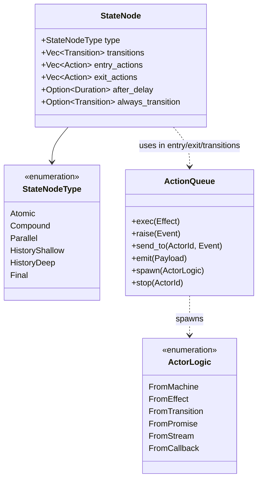

# Port XState v6 into Rust as elm-effect-xstate with 100% Behavioral Conformance

## Context and Problem Statement

[ADR-0006](0006-integrate-harel-statecharts-into-the-elm-loop.md) established the need for Harel statecharts to resolve state space explosion, message delegation boilerplate, and background command leakage in the Elm loop.

However, complex distributed multi-agent swarms (such as the flywheel x toron ecosystem), rich terminal interfaces, and resilient backend workflows demand more than a simple state machine helper. They require the full expressive power of the **Harel Statechart formalism** and the **Actor Model**:
- **Compound (Hierarchical) States**: Inheritance of transitions, localized contexts, and automatic bubbling.
- **Parallel (Orthogonal) Regions**: Concurrent sub-states running simultaneously with synchronized join conditions.
- **History States**: Resuming dynamic compound states at shallow or deep interruption points.
- **Eventless (`always`) & Delayed (`after`) Micro-steps**: Cascading transitions and automated time-triggered state changes.
- **Decentralized Actor Systems**: Dynamic spawning, bidirectional message passing (`send_to`), and hierarchical supervisor trees.

In TypeScript, [Stately's XState v6](https://github.com/statelyai/xstate) represents the gold standard for statechart and actor implementations. However, running statecharts in JavaScript carries inherent structural limitations:
1. Delayed transitions depend on wall-clock `setTimeout`, making automated tests flaky or slow.
2. JavaScript promises cannot be cancelled, causing background work to leak when states exit.
3. State recovery after process crash requires bespoke persistence layers without monotonic fencing.

How should `elm-effect-rs` deliver a **100% behaviorally conformant port of XState v6** for end-users, while leveraging our carrier ([`elm-effect`](../../crates/elm-effect)) to make it deterministically testable, memory-safe, leak-free, and crash-proof?

## Decision Drivers

* **100% Behavioral Parity with XState v6**: Port all canonical primitives, verbs, execution orders, and actor logic types, verified against XState's reference test suite (~400 test cases).
* **Zero Blast Radius to Existing Kernel**: The port lives in a dedicated, additive crate ([`crates/elm-effect-xstate`](../../crates/elm-effect-xstate)). The 6 kernel crates remain lean, pristine, and independently usable.
* **Carrier Integration ([ADR-0002](0002-port-effect-4-into-rust-with-an-elm-loop.md))**: All async operations, delays, and background tasks run as managed `Effect<A, E, R>` descriptions.
* **Leak-Free Concurrency ([ADR-0003](0003-make-elm-effect-a-first-class-rust-framework.md))**: Actor and state lifetimes are strictly bound to [`elm-effect::Scope`](../../crates/elm-effect/src/scope.rs). Exiting a state or stopping an actor immediately cancels child fibers and runs LIFO finalizers.
* **Deterministic Virtual Time**: Delayed transitions (`after`) run natively on [`elm-effect-test::TestClock`](../../crates/elm-effect-test/src/clock.rs), enabling instant simulation of long delays with zero wall-clock sleep.
* **Crash-Proof Durability ([ADR-0005](0005-durable-engine-port-and-our-engine.md))**: Statechart transitions seamlessly log to [`elm-effect-journal::DurableLog`](../../crates/elm-effect-journal/src/durable_log.rs) for deterministic crash recovery.
* **Dual Type Strategy**: Strongly typed algebraic enums for end-user DX (zero-cost, compile-time verified) alongside a dynamic graph representation for W3C/SCXML test suite conformance.

## Considered Options

* **Option 1: Minimal Wrapper around the Elm Loop (ADR-0006 Scope Only)**. Keep statecharts as a shallow helper trait in `elm-effect-elm`. Omits parallel regions, history states, eventless transitions, and the actor model.
* **Option 2: Standalone Crate in a Separate Repository**. Build `xstate-rs` independently of `elm-effect-rs`. Loses direct integration with `TestClock`, `Scope`, and `DurableLog`.
* **Option 3: First-Class Workspace Crate `elm-effect-xstate` with 100% Conformance [Chosen Option]**. Build `crates/elm-effect-xstate` within the workspace as a first-class citizen, backed by the Effect carrier and validated by an exhaustive differential conformance harness.

## Decision Outcome

Chosen option: **Option 3 ("First-Class Workspace Crate `elm-effect-xstate` with 100% Conformance")**.

We create [`crates/elm-effect-xstate`](../../crates/elm-effect-xstate) implementing the complete XState v6 specification.

### 1. The Core Laws of `elm-effect-xstate`

1. **L1: Strict Execution Ordering**:
   Upon any state transition from $S_1$ to $S_2$:
   $$\text{Exit}(S_1) \longrightarrow \text{Actions}(\text{Transition}) \longrightarrow \text{Context Update} \longrightarrow \text{Entry}(S_2)$$
   Exit actions run from deepest descendant to ancestor; entry actions run from ancestor to deepest descendant.
2. **L2: Scope-Bound Lifecycles**:
   Every state node that invokes an effect or spawns an actor opens a child [`Scope`](../../crates/elm-effect/src/scope.rs). When the state node is exited (or preempted by an ancestor transition), the scope closes immediately, interrupting the child fibers and executing LIFO finalizers.
3. **L3: Virtualized Time Determinism**:
   Delayed transitions (`after`) register with the active [`Clock`](../../crates/elm-effect/src/time.rs). In test targets, [`TestClock`](../../crates/elm-effect-test/src/clock.rs) advances time programmatically, eliminating flaky timers and thread sleeps.
4. **L4: Eventless Run-to-Completion**:
   `always` transitions evaluate in micro-steps immediately upon entering a state. External events are queued until all enabled eventless transitions reach a stable quiescent configuration.
5. **L5: Durable Transition Logging**:
   When durability is enabled, transition records `(from_state, event, to_state, generation)` commit to [`elm-effect-journal`](../../crates/elm-effect-journal) before entry actions run.

### 2. Comprehensive Primitive & Verb Specification

#### A. State Primitives
- **Atomic**: Leaf state node.
- **Compound**: Hierarchical state containing sub-states and an initial child target.
- **Parallel**: Orthogonal state running multiple child regions simultaneously.
- **History (Shallow)**: Remembers the immediate substate active prior to exit.
- **History (Deep)**: Remembers the full leaf state configuration active prior to exit.
- **Final**: Signifies completion of a compound state (emitting `done.state.<name>`) or the entire machine.

#### B. Transition Verbs
- **`on(event, transition)`**: Reactive event handling with pure boolean guards.
- **`always(transition)`**: Transient micro-step triggered without an event.
- **`after(duration, transition)`**: Delayed transition scheduled on virtual time.
- **`target(state)`**: Defines destination state.
- **`guard(predicate)`**: Pure conditional filter `(&Context, &Event) -> bool`.

#### C. Action Verbs (XState v6 Unified Enqueue Discipline)
In compliance with XState v6's removal of action creator indirection:
- **`enq.exec(Effect)`**: Dispatches an algebraic effect into the host concurrency window.
- **`enq.raise(Event)`**: Emits an internal priority event into the active machine's inbox.
- **`enq.send_to(target, Event)`**: Sends an asynchronous message to a child or peer actor.
- **`enq.emit(Payload)`**: Streams telemetry/events to external inspection observers.
- **`enq.spawn(ActorLogic)`**: Spawns a new actor bound to the current state's scope.
- **`enq.stop(ActorRef)`**: Terminates an active child actor.

#### D. The Unified Actor Model (`ActorLogic`)
Every active process is an actor implementing `ActorLogic`:
1. **`from_machine(Machine)`**: Hierarchical state machine actor.
2. **`from_effect(Effect)`**: Managed algebraic effect running in a scoped fiber.
3. **`from_transition(Reducer)`**: Pure event reducer `(state, event) -> state`.
4. **`from_promise(Future)`**: One-shot async task resolving to `onDone` or `onError`.
5. **`from_stream(Channel)`**: Stream consumer feeding events into the machine.
6. **`from_callback(Handler)`**: Interactive callback actor for bidirectional protocols.

### 3. Conformance & Verification Strategy

To guarantee 100% behavioral parity:
1. **Port the XState Reference Test Corpus**:
   Port the ~400 unit tests from Stately's official `packages/core/test/` directory into `crates/elm-effect-xstate/tests/conformance/`:
   - `actions.rs`: Strict execution sequence, nested action queues, self-transitions.
   - `always.rs`: Eventless loops, transient cascades, micro-step quiescence.
   - `after.rs`: Timer cancellation on preemptive transitions, zero-delay microtasks.
   - `parallel.rs`: Cross-region synchronization, simultaneous event distribution.
   - `history.rs`: Deep vs shallow targeting, unvisited history fallback.
   - `actors.rs`: Actor lifecycle isolation, parent-child message queues, supervisor faults.
2. **Automated TLA+ Verification**:
   Every statechart exposes `.to_tla()` and `.to_mermaid()`, hooking directly into [`scripts/verify-formal.sh`](../../scripts/verify-formal.sh) for formal model-checking.

## Consequences

### Positive
* **Complete Statechart & Actor Parity**: Delivers the full expressive power of Harel statecharts and actor systems to the Rust ecosystem.
* **Leak-Free by Construction**: Structured scopes eliminate dangling promises and orphaned background tasks.
* **Blazing Fast Testing**: Virtual time via `TestClock` tests multi-day timeouts in single-digit milliseconds.
* **Crash-Proof Durability**: Native WAL logging enables transparent actor crash recovery.
* **Zero Kernel Impact**: Preserves the minimalism, speed, and integrity of the 6 underlying crates.

### Negative / Tradeoffs
* **Implementation Scale**: Requires implementing the full statechart algorithm (~3,000 lines of core engine code + ~2,500 lines of conformance tests).
* **Dual Type Complexity**: Maintaining both a dynamic graph for conformance test vectors and a typed macro builder for end-user DX.

## Implementation Plan

### Phases & Milestones

1. **Milestone 1: Crate Scaffold & Core State Node Graph**:
   - Create `crates/elm-effect-xstate`.
   - Implement `StateNode`, `StateGraph`, `Transition`, `Context`, and `ActionQueue`.
   - Validate atomic, compound, and parallel state transitions.
2. **Milestone 2: Conformance Test Suite (Actions, Always, After, History)**:
   - Port XState v6 test vectors into `tests/conformance/`.
   - Implement eventless (`always`) micro-step loop and quiescence detector.
   - Integrate `after` with `elm-effect::time` and `TestClock`.
   - Implement shallow and deep history state resolution.
3. **Milestone 3: The Unified Actor Model**:
   - Implement `ActorSystem`, `ActorRef`, and `ActorLogic`.
   - Implement `from_effect` binding child fibers to state `Scope`.
   - Implement `send_to`, `spawn`, and `stop`.
4. **Milestone 4: Durability, Inspection & Visualizer**:
   - Connect state transitions to `elm-effect-journal::DurableLog`.
   - Expose `.to_mermaid()` and `.to_tla()` exporters.
   - Add verification target to `scripts/verify-formal.sh`.

### Verification

- [ ] `crates/elm-effect-xstate` compiles cleanly under `cargo check --workspace`.
- [ ] Conformance suite passes 100% of ported tests (`actions`, `always`, `after`, `parallel`, `history`, `actors`).
- [ ] `after` delayed transitions simulate deterministically under `TestClock` with 0ms wall-clock wait.
- [ ] Scope lifecycle test proves state exit terminates child fibers and executes LIFO finalizers.
- [ ] Replay test proves crashed actor resumes from exact journal snapshot without re-executing side effects.
- [ ] `to_mermaid()` outputs valid Mermaid diagrams matching TLC formal models.
- [ ] Full workspace passes `cargo test --workspace`, `clippy` (0 warnings), and `fmt`.

## More Information

- [ADR-0002: Port Effect 4.0.0 into a Rust Carrier with an Elm Loop](0002-port-effect-4-into-rust-with-an-elm-loop.md)
- [ADR-0005: Durable Engine Port and Our Single-Host Engine](0005-durable-engine-port-and-our-engine.md)
- [ADR-0006: Integrate Harel Statecharts into the Elm Loop](0006-integrate-harel-statecharts-into-the-elm-loop.md)
- [Stately.ai XState v6 Migration & Architecture](https://stately.ai/docs/migrate-from-xstate-v5-to-v6)
- [W3C State Chart XML (SCXML) Specification](https://www.w3.org/TR/scxml/)
