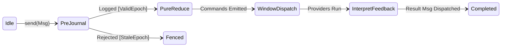
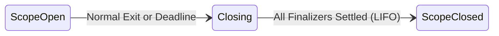

# Framework flows and statecharts

This guide describes the state machines and execution flows of `elm-effect`.

Full formal proofs and TLA+ models live in [`docs/research/state-machines-and-flows.md`](../research/state-machines-and-flows.md) and [`skills/verify-framework-flows`](../../skills/verify-framework-flows).

## 1. The Elm loop (UX)

The Elm loop runs a state machine in three stages:
1. **Pre-dispatch append**: The incoming message appends to the durable log before the fold runs. Stale producers fence here.
2. **Pure fold**: `Program::update` takes `(model, msg)` and returns `(new_model, commands)`. No I/O happens in this step.
3. **Command window**: The runtime executes commands in a bounded concurrency window. Outcomes return as new messages.

## 2. Structured concurrency and scopes (DX)

A fiber belongs to a scope. When a scope closes:
1. Child fibers receive an interrupt signal.
2. Responsive fibers exit at interrupt check points.
3. Unresponsive fibers are quarantined and named by fiber ID; the scope does not hang.
4. Finalizers run in strict reverse (LIFO) order.

## 3. Durable sagas and compensation (AX)

A saga coordinates compensable workflow steps:
1. Steps run forward in order. Forward progress commits to the journal.
2. When a step fails, compensation plans run in strict reverse (LIFO) order over completed steps only.
3. The saga settles as failed with a generation fence.

## 4. Signal latching and park-commit gap

In `OurEngine`, `await_signal` checks for latched signals before parking:
1. A signal that arrives before parking resumes immediately.
2. A signal that arrives in the commit gap re-checks run liveness. Cancelled or terminal runs refuse resurrecting into `Signalled`.
