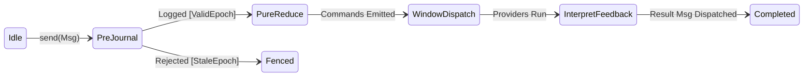
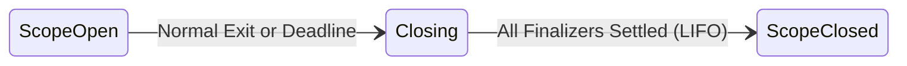

# Framework flows and statecharts

This guide describes the state machines and execution flows of `elm-effect`.

Full formal proofs and TLA+ models live in [`docs/research/state-machines-and-flows.md`](../research/state-machines-and-flows.md), [`skills/verify-framework-flows`](../../skills/verify-framework-flows), [`skills/verify-signal-latch`](../../skills/verify-signal-latch), and [`skills/verify-lease-fencing`](../../skills/verify-lease-fencing).

All models run via `scripts/verify-formal.sh`.

## 1. The Elm loop (UX)

The Elm loop runs a state machine in three stages:
1. **Pre-dispatch append**: The incoming message appends to the durable log before the fold runs. Stale producers fence here.
2. **Pure fold**: `Program::update` takes `(model, msg)` and returns `(new_model, commands)`. No I/O happens in this step.
3. **Command window**: The runtime executes commands in a bounded concurrency window. Outcomes return as new messages.

## 2. Structured concurrency and scopes (DX)

A fiber belongs to a scope. When a scope closes:
1. Child fibers receive an interrupt signal.
2. Responsive fibers exit at interrupt check points.
3. Unresponsive fibers are quarantined and named by fiber ID; the scope does not hang.
4. Finalizers run in strict reverse (LIFO) order.

## 3. Durable sagas and compensation (AX)

A saga coordinates compensable workflow steps:
1. Steps run forward in order. Forward progress commits to the journal.
2. When a step fails, compensation plans run in strict reverse (LIFO) order over completed steps only.
3. The saga settles as failed with a generation fence.

Use [`SagaCoordinator`](../../crates/elm-effect-journal/src/saga.rs) to track forward milestones (`record_completed`, `record_failed`, `record_skipped`) and generate strict LIFO [`SagaPlan`](../../crates/elm-effect-journal/src/saga.rs) manifests.

## 4. Signal latching and park-commit gap

In `OurEngine`, `await_signal` checks for latched signals before parking:
1. A signal that arrives before parking resumes immediately.
2. A signal that arrives in the commit gap re-checks run liveness. Cancelled or terminal runs refuse resurrecting into `Signalled`.

For runtime diagnostics, `OurEngine::query_lease(key, now_ms)` reports [`LeaseStatus`](../../crates/elm-effect-durable/src/lease.rs) (`Active`, `Expired`, or `Unheld`) without mutating storage or fences.

## 5. Execution lease reclaim, generation fencing, and split-brain elimination

Under [ADR-0005](../decisions/0005-single-host-engine.md), execution leases enforce single-writer mutual exclusion:
1. When a worker claims a lease, the journal increments `generation` monotonically and binds the deadline.
2. If a worker stalls across its deadline, another worker may reclaim the lease with generation $G+1$.
3. When the stalled worker unpauses and attempts to settle, heartbeat, or write to storage, the storage fence rejects it with `StaleGeneration`, eliminating split-brain execution.

Formally verified in [`skills/verify-lease-fencing`](../../skills/verify-lease-fencing).

## 6. Statechart microstep quiescence and LCA resolution

In [`elm-effect-xstate`](../../crates/elm-effect-xstate), state transitions execute in strict topological order:
1. Active states exit from deepest descendant up to the Least Common Ancestor (LCA).
2. Transition actions and context assignments execute in declaration order (Law L1).
3. Target states enter from LCA down to leaves, resolving initial compound states.
4. Eventless (`always`) transitions cascade in micro-steps until reaching quiescence (Law L2).

Formally verified in [`flow6_statechart_microstep.tla`](../../skills/verify-framework-flows/flow6_statechart_microstep.tla).

## 7. Parallel orthogonal regions and synchronized join

Parallel state nodes maintain independent active leaves across orthogonal regions:
1. An event is offered to every region simultaneously.
2. A transition in one region preserves active states in sibling regions.
3. The parallel state emits `onDone` and completes if and only if all regions reach final states.

Formally verified in [`flow7_statechart_parallel.tla`](../../skills/verify-framework-flows/flow7_statechart_parallel.tla).

## 8. Actor supervision and scoped lifecycles

Every actor in [`ActorSystem`](../../crates/elm-effect-xstate/src/actor.rs) owns an [`elm-effect::Scope`](../../crates/elm-effect/src/scope.rs) forked from its parent:
1. Stopping an actor recursively stops its descendants deepest-first.
2. Child fibers are cancelled and LIFO finalizers execute cleanly.
3. Mailbox messages are delivered in deterministic FIFO order.

Formally verified in [`flow8_statechart_actor.tla`](../../skills/verify-framework-flows/flow8_statechart_actor.tla).

## 9. Virtualized delayed transitions and preemptive cancellation

Delayed transitions (`after`) generate `TimerIntent` data without sleeping:
1. `TimerIntent::Start` schedules a virtual timer on the active clock.
2. Early transitions away from the state issue `TimerIntent::Cancel`, invalidating the timer.
3. Stale timer wakeups arriving after state exit are discarded as harmless no-ops.

Formally verified in [`flow9_statechart_timer.tla`](../../skills/verify-framework-flows/flow9_statechart_timer.tla). For full guide see [Harel statecharts](18-xstate.mdx).
