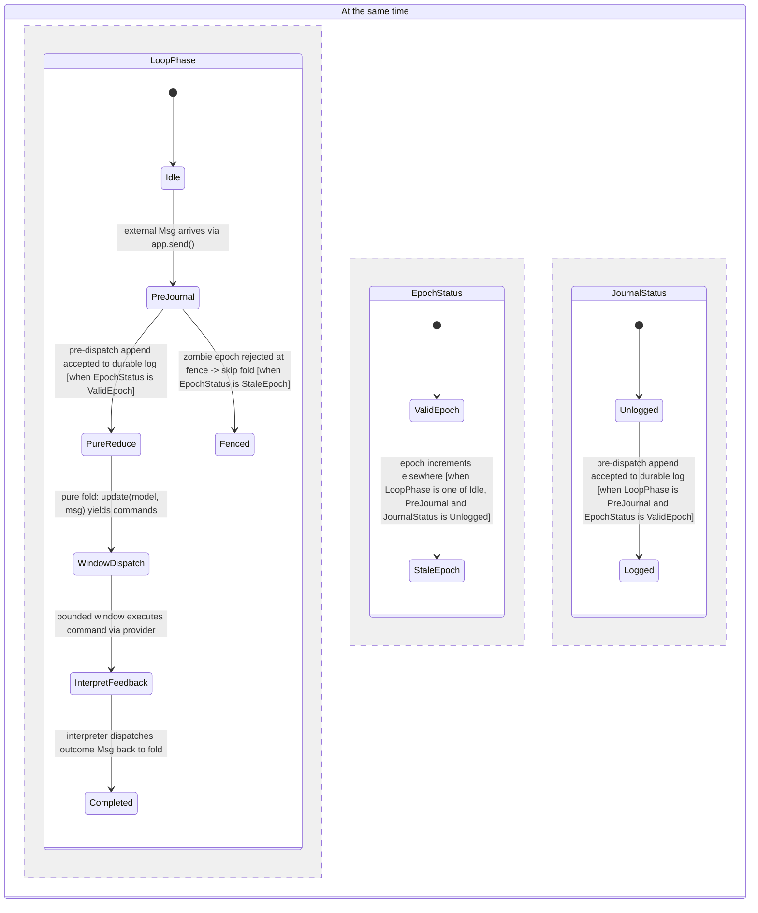
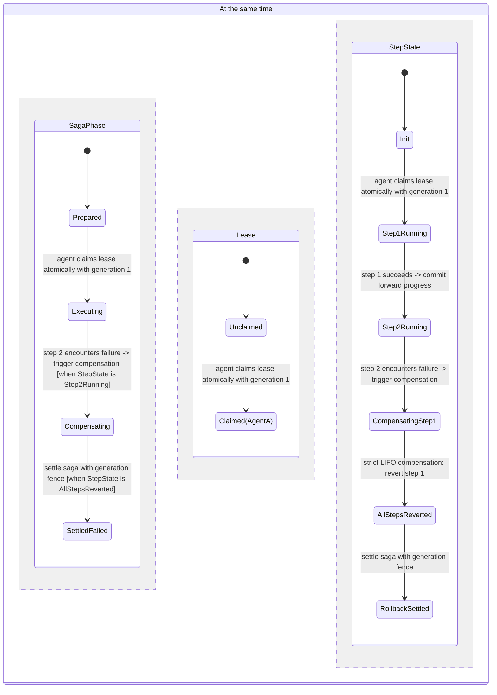
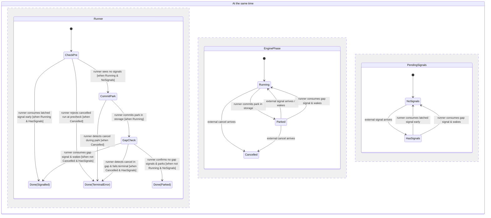

# State Machines and Framework Flows in `elm-effect-rs`

This document serves as the permanent architectural reference for all implicit and explicit state machines in `elm-effect-rs`, including formal TLA+ proofs, state invariants, and verified Mermaid statecharts.

---

## 1. Executive Summary & Foundational Invariants

`elm-effect-rs` integrates purely functional Elm loops (`elm-effect-elm`), structured concurrency (`elm-effect`), durable command logging (`elm-effect-journal`), and an in-process durable workflow engine (`elm-effect-durable`).

### Foundational Invariants
1. **Deferred Execution**: An `Effect<A, E, R>` is a lazy description until executed at the process boundary (`Runtime::run`) or via command interpretation.
2. **Four Strict Outcomes**:
   - `Success(A)`: Typed value.
   - `Fail(E)`: Typed domain failure by value.
   - `Die(Defect)`: Panics, contract breaks, and assertions.
   - `Interrupt`: Cooperative cancellation delivered at yield points.
   *Invariant*: A typed failure handler can never swallow a defect or an interrupt.
3. **Pure Reducer Discipline**: `Program::update(model, msg) -> Update(new_model, commands)`. The reducer is purely functional and deterministic.
4. **Pre-Dispatch Journaling**: Messages are journaled *before* the fold consumes them; durable command intents are persisted *before* providers execute.
5. **Parked Boundary Law**: [`can_transition`](../../crates/elm-effect-journal/src/lib.rs) has exactly **18 directed edges**. `Parked` has **0 edges** because parking is an engine-level storage phase (`RunPhase::Parked`), not an effect row state in the journal.
6. **Lineage Rollover Law (`continue_as_new`)**: Under ADR-0005, a pre-settled next epoch re-attaches and closes the previous epoch (`law_next_terminal`).

---

## 2. Crucial Framework Flows (Formally Verified Statecharts)

All four statecharts below have been verified with TLA+ model checking via the `/statechart` skill.

### Flow 1 (UX): The Elm Loop Reactive Cycle
- **Crate**: [`crates/elm-effect-elm`](../../crates/elm-effect-elm)
- **Model**: [`skills/verify-framework-flows/flow1_elm_loop.tla`](../../skills/verify-framework-flows/flow1_elm_loop.tla)
- **Invariants**: `NoReduceWithoutJournal`, `NoDispatchWhenFenced`

---

### Flow 2 (DX): Structured Concurrency & Bounded Straggler Quarantine
- **Crate**: [`crates/elm-effect`](../../crates/elm-effect)
- **Model**: [`skills/verify-framework-flows/flow2_concurrency.tla`](../../skills/verify-framework-flows/flow2_concurrency.tla)
- **Invariants**: `NoHangingOnStraggler`, `AllFinalizersRunBeforeClose`

```mermaid
stateDiagram-v2
  direction LR
  state "At the same time" as all {
    state "Scope" as r0 {
      s0: ScopeOpen
      s1: Closing
      s2: ScopeClosed
      [*] --> s0
      s0 --> s1: scope initiates normal close [when Fiber is Completed and Deadline is Pending]
      s0 --> s1: scope initiates close and signals interrupt [when Fiber is Running and Deadline is Expired]
      s1 --> s2: all finalizers settled; scope closed cleanly [when Fiber is not InterruptSignalled]
    }
    --
    state "Fiber" as r1 {
      s3: Created
      s4: Running
      s5: Completed
      s6: InterruptSignalled
      s7: Interrupted
      s8: StragglerQuarantined
      [*] --> s3
      s3 --> s4: fork child fiber attached to parent scope
      s4 --> s5: child fiber runs to clean exit [when Deadline is Pending]
      s4 --> s6: scope initiates close and signals interrupt [when Deadline is Expired]
      s6 --> s7: responsive fiber yields at interrupt boundary
      s6 --> s8: unresponsive fiber quarantined & named by ID
    }
    --
    state "Deadline" as r2 {
      s9: Pending
      s10: Expired
      [*] --> s9
      s9 --> s10: bounded deadline fires [when Scope is ScopeOpen and Fiber is Running]
    }
  }
```

---

### Flow 3 (AX): Durable Saga, Generation Fencing & LIFO Compensation
- **Crate**: [`crates/elm-effect-journal`](../../crates/elm-effect-journal) & [`crates/elm-effect-durable`](../../crates/elm-effect-durable)
- **Model**: [`skills/verify-framework-flows/flow3_saga.tla`](../../skills/verify-framework-flows/flow3_saga.tla)
- **Invariants**: `RollbackMatchesCompleted`, `NoExcessCompensation`

---

### Flow 4: Durable Signal Latch & Park Commit-Gap Race
- **Crate**: [`crates/elm-effect-durable`](../../crates/elm-effect-durable)
- **Model**: [`skills/verify-signal-latch/signal_latch.tla`](../../skills/verify-signal-latch/signal_latch.tla)
- **Invariants**: `NoResurrectOnSignal`, `NoLostWakeup`, `LiveWhenSignalled`

---

## 3. Catalog of All 15 State Machines

| # | Machine | Subsystem | Code Location | Key Transitions |
|---|---|---|---|---|
| 1 | Fiber Lifecycle | `elm-effect` | `fiber.rs` | `Created` -> `Running` -> `Done(Exit)` / `Interrupted` |
| 2 | Scope LIFO Stack | `elm-effect` | `scope.rs` | `Open` -> `Closing` -> `Closed` (LIFO unwind) |
| 3 | Schedule State | `elm-effect` | `schedule.rs` | `Running` -> `Step(Wait)` -> `Terminal` |
| 4 | Deferred Latch | `elm-effect` | `sync.rs` | `Pending` -> `Done(Value)` (Write-once latch) |
| 5 | TestClock Time | `elm-effect-test` | `clock.rs` | `VirtualTime(T)` -> `Adjust(Δ)` -> `WakeSleepers` |
| 6 | Loop Fold Core | `elm-effect-elm` | `lib.rs` | `Idle` -> `PreJournal` -> `Reduce` -> `Dispatch` |
| 7 | Crash Recovery | `elm-effect-elm` | `crash_recovery.rs` | `Replay(0..N)` -> `CatchUp` -> `LiveFold` |
| 8 | EffectState Registry | `elm-effect-journal` | `lib.rs` | 18 canonical edges (`Accepted`, `Settled`, `Failed`, `Cancelled`, `Unknown`) |
| 9 | DispatchPlan Attempt | `elm-effect-journal` | `plan_attempt.rs` | `New` -> `Retry` -> `Exhausted` -> `DeadLetter` |
| 10 | ParkPlan Evaluation | `elm-effect-journal` | `plan_park.rs` | `Wait(until_ms)` vs `ResumeNow` vs `RefusedOverCeiling` |
| 11 | Saga LIFO Rollback | `elm-effect-journal` | `saga.rs` | `Prepared` -> `Executed` -> `Compensating(LIFO)` -> `Settled` |
| 12 | Engine RunPhase | `elm-effect-durable` | `engine.rs` | `Running` -> `Parked` -> `Settled` / `Failed` / `Cancelled` |
| 13 | Lease Heartbeat | `elm-effect-durable` | `runtime.rs` | `Claimed(Gen)` -> `Renew(Gen)` -> `Expired(Reconcile)` |
| 14 | Signal Latching | `elm-effect-durable` | `signal.rs` | Pre-check -> Park -> Gap check -> Wake (Liveness checked) |
| 15 | Lineage Rollover | `elm-effect-durable` | `lineage.rs` | `Epoch(N)` -> `Rollover` -> `Epoch(N+1)` (`law_next_terminal`) |
